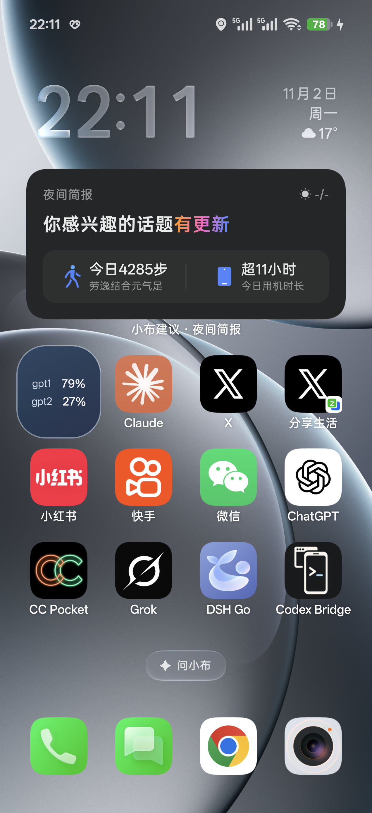

# Codaze 卡片

Codaze 网关的安卓桌面额度卡片。本仓库只存放发布 APK 与更新清单（`latest.json`），源码与问题反馈在私有项目仓库。



## 下载

| 文件 | 说明 |
| --- | --- |
| [latest.json](latest.json) | 更新清单（版本号、下载地址、SHA-256） |
| [codaze-card-1.5.3.apk](codaze-card-1.5.3.apk) | 最新 APK（1.5.3 / versionCode 9） |

也可以直接拉取原始文件：

```
https://raw.githubusercontent.com/leesama/codaze-card/main/codaze-card-1.5.3.apk
```

## 功能

- **多账号额度展示**：登录 https://codaze.leesher.fun/ 后，卡片按行显示每个账号名称与 7 天剩余额度百分比，最多 4 行，刷新后自动同步。
- **三档自适应布局**：大卡片显示 5 小时 / 7 天双窗口进度条与状态文字；拖小到约半宽切换紧凑单行进度条；缩到 1×1 格自动变成迷你模式，每行一个「账号名 + 百分比」并整体居中。
- **可勾选账号**：在 App 内勾选要在卡片上显示的账号，多账号只看关心的那几个。
- **点击刷新**：轻点卡片任意位置立即刷新并显示加载动画，无需打开 App。
- **定时更新**：系统周期（约 30 分钟）自动拉取最新额度；数据本地缓存，重启桌面不丢。
- **应用内自动更新**：启动时检查本仓库的 `latest.json`，有新版本即提示一键安装，无需卸载重装。
- **免密登录**：直接复用 Codaze 网页端会话，无需在卡片 App 里再次输入凭据。

## 使用方法

1. 下载并安装上面的 APK（允许安装未知来源应用）。
2. 打开 App，登录 Codaze（与网页端共用会话）。
3. 长按桌面 → 添加小部件 → 选择「Codaze 卡片」，按需拖拽调整大小。

## 更新日志

| 版本 | 说明 |
| --- | --- |
| 1.5.3 | 迷你卡片：名称与百分比在卡片内居中显示，行间保留间距 |
| 1.5.2 | 迷你卡片支持逐行显示多个账号，最小可缩到 1×1 格 |
| 1.5.1 | 新增开源 APK 仓库与应用内自动更新 |
